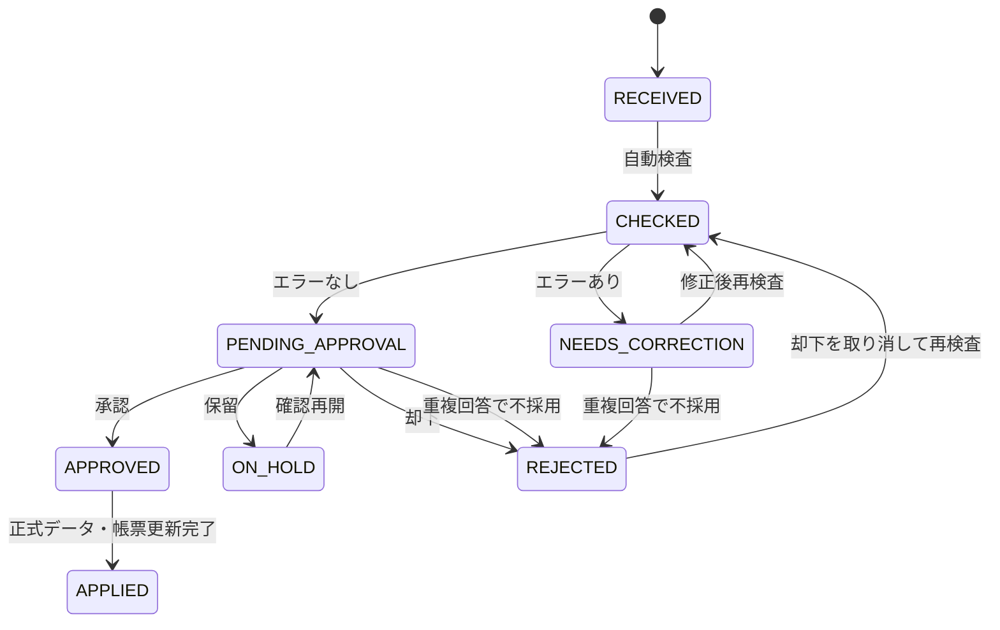

# データモデル

## 1. 基本方針

- 正式データの正本は中央管理ファイルの`登録データ`。
- フォーム回答、申請、検査結果、承認履歴、帳票を分離する。
- 行番号ではなく一意IDで関連付ける。
- 帳票は派生データであり、直接編集しない。

## 2. 生徒マスター

本番用の`生徒マスター`シートと、開発用の`疑似生徒マスター`シートを分離する。

- `生徒マスター`はA列`student_id`、B列`name`、F列`gender_m_or_f`を人が入力する。性別は大文字・小文字を問わず`m`または`f`とする。C列`grade`、D列`class_number`、E列`attendance_number`は4桁学籍番号から数式で自動表示し、処理時にも学籍番号から再計算する。
- `生徒マスター`のA列またはB列に1件でも入力があれば、本番用をすべての検査・名簿処理で優先する。
- `生徒マスター`が全行空欄のときだけ`疑似生徒マスター`へ自動的に切り替える。
- 片側だけの入力、4桁でない番号、重複番号がある場合は、疑似マスターへ戻さず行番号付きエラーで処理を止める。
- 本番切り替え前に疑似申請を削除し、本番用マスターの入力人数と入力漏れを人が確認する。

最低限必要な論理項目:

| 項目 | 説明 |
|---|---|
| `student_id` | 4桁学籍番号 |
| `grade` | 1〜3 |
| `class_number` | 1〜8 |
| `attendance_number` | 原則1〜40、例外あり |
| `name` | 氏名 |

例: `1324` = 1年3組24番。

有効性は番号範囲ではなく、生徒マスターに存在するかで判定する。

内部の性別は`M`、`F`、未入力の`U`へ正規化する。論理式では未入力・不明・学籍番号不正を`UNKNOWN`へ含める。

### 開発用疑似データ

疑似データは、現在の`フォーム設計`に保存された通常・修正フォームIDと、そのフォームIDに対応する`フォーム項目対応表`から生成する。競技、選手枠、走順、必須・任意を固定値で持たない。

`フォーム設計.締切`はスプレッドシート上では日付型で保持し、タイムゾーンは`Asia/Tokyo`、ロケールは`ja_JP`とする。アプリ内へ読み込む際は曜日を再計算して`yyyy/MM/dd(曜)`の文字列に正規化する。

- 通常フォームと修正フォームの両方が作成済みであることを必須とする。
- 通常回答、代理入力、存在しない番号・所属不一致、受付停止中の修正、同一クラスの複数回答を作る。
- フォームの全学籍番号欄に対応する疑似回答を作り、`フォーム回答原本`、`承認待ち`、`申請項目`を同じ申請IDで関連付ける。
- 同じ`field_key`が学年別ページに複数存在する場合は、回答1件につき1項目として扱う。
- フォーム、登録データ、帳票は変更しない。
- 疑似データ削除では、`mock-response-数値`の回答IDと、それを末尾に持つ申請IDだけを開発用データとして削除する。識別できない回答や申請は削除しない。
- `疑似データ設定`は対象学年1〜3年、対象クラス1〜8組、通常フォーム、修正フォームのチェック状態、`エラーを含む申請数`、`警告を含む申請数`を持つ。疑似申請数は、通常フォームだけなら対象クラス数、修正フォームを含むなら対象学年と対象クラスに該当する疑似生徒数から自動計算する。初期状態は全学年・全クラス・両フォームを選択する。両フォームを選んだ場合は各クラスの最初の1回答だけ通常フォームとし、その後は修正フォームを生成する。
- エラー申請と警告申請は重ならない。残りは問題なしの申請とする。
- 24クラスへ順番に回答を割り当て、最初の各クラス回答は通常フォーム、その後は修正フォームの競技を循環して全校規模まで増やす。

### 運用モードと本番切替

運用モードは`システム設定`シートの`運用モード`を正本とし、Script Propertyの`SYSTEM_MODE`を互換用の副本とする。値は`PRODUCTION`、`DEVELOPMENT`、練習用コピーの`PRACTICE`のいずれかとする。

- モード判定はシートの値を優先し、`DEVELOPMENT`または`PRACTICE`であれば`SYSTEM_MODE`が`PRODUCTION`のままでも開発用モードとする。シートに値がないときだけ`SYSTEM_MODE`で判定する。
- モードの書き換えでは`運用モード`の行だけを更新し、`練習用保存フォルダID`など他の行を消さない。開発用モードへ戻すときは`SYSTEM_MODE`も削除する。
- 本番モードへの切替は、名簿作成の実行中とフォームの公開前確認中は実行しない。公開待ちの旧フォームIDが残っている場合は、そのフォームの回答も削除対象に含める。
- 本番モードへの切替では、開発用データを先に削除してからモードを書き換える。削除対象は`承認待ち`、`申請項目`、`検査結果`、`承認履歴`、`変更履歴`、`フォーム回答原本`、`登録データ`、`疑似生徒マスター`、`疑似データ設定`、`実機テスト`、`選手名簿作成履歴`、`名簿作成状況`、`設定点検結果`、`操作画面`のデータ行と、名簿作成の一時シート（`_名簿登録作成中_`・`_名簿申請作成中_`で始まるシート）、名簿作成の途中状態、および通常・修正フォームに届いている全回答とする。
- 本番切替時だけは`mock-response-数値`で識別できない行も削除する。実機テストで本物のフォームから送信した回答は疑似IDを持たず、識別方式では残ってしまうためである。切替前のデータはすべて開発用という前提で運用する。
- `生徒マスター`、`競技設定`、`ルール設定`、`フォーム設計`、`フォーム項目対応表`、`設定変更履歴`、`公開設定スナップショット`、Googleフォーム本体は削除しない。
- 開発中に作成した選手名簿のDriveフォルダは削除しない。`選手名簿作成履歴`の`folder_url`を切替時に表示し、担当者が手動で削除する。
- 本番切替と開発用モードへの復帰は、どちらも`設定変更履歴`へ実行者・日時・理由付きで記録する。

### 全体警告

`STUDENTS_WITHOUT_REGISTRATION`は申請項目ではなく全体の点検結果である。登録されていない生徒が複数いても、`出場していない生徒がN人います`の1件だけを表示する。警告には該当生徒の学籍番号、学年、組、氏名を含め、画面では学年・組・学籍番号順に表示する。通常運用では`登録データ`の学籍番号、開発用疑似申請が存在する場合は現在の`申請項目`で`REGISTER`になっている学籍番号を生徒マスターと比較する。

## 3. 主要エンティティ

### Submission

| フィールド | 内容 |
|---|---|
| `submission_id` | 申請ID |
| `submission_type` | `INITIAL` / `CORRECTION` / `MANUAL_CHANGE` |
| `submitted_at` | 送信日時 |
| `submitter_student_id` | 回答責任者学籍番号 |
| `submitter_name_input` | 入力氏名 |
| `submitter_email` | 自動収集メール |
| `target_grade` | 対象学年 |
| `target_class` | 対象組 |
| `status` | 申請状態 |
| `warning_count` | 未解決警告件数 |
| `error_count` | 未解決エラー件数 |

### SubmissionItem

| フィールド | 内容 |
|---|---|
| `submission_item_id` | 項目ID |
| `submission_id` | 申請ID |
| `submitter_student_id` | 回答責任者の学籍番号。`承認待ち`から参照して運用シートへ複写 |
| `submitter_name_input` | 回答責任者の入力氏名。`承認待ち`から参照して運用シートへ複写 |
| `event_id` | 競技ID |
| `slot_id` | 枠ID |
| `student_id_input` | 入力学籍番号 |
| `student_name_input` | 入力氏名。フォームの選手枠に氏名欄はなく、学籍番号のみの回答では空欄になる。互換のため列自体は残し、氏名欄があった頃の旧回答や管理画面からの学籍番号修正時（生徒マスターの氏名を複写）には値が入る |
| `normalized_name` | 正規化後氏名。`student_name_input`が空欄の場合は空欄になる |
| `registration_state` | 登録 / 調整中 / 出場しない |

フォームの選手枠には氏名入力欄がないため、通常のフォーム送信では`student_name_input`は空欄のまま保存される。`申請項目`シートの`student_name_input`は、氏名欄があった頃の旧回答の氏名をそのまま保持する列として残しており、再検査でこの値を生徒マスターの氏名へ上書きしない。管理画面から学籍番号を修正した場合だけ、修正後の学籍番号に対応する生徒マスターの氏名を同時に`student_name_input`へ保存する。氏名照合は`student_name_input`に値がある回答だけを対象とし、半角・全角・改行・タブ・ゼロ幅空白を除去して比較する。学籍番号のみの回答（`student_name_input`が空欄）は氏名照合の対象にならない。承認サイドバーの氏名表示は、学籍番号から生徒マスターを引いた氏名を優先し、名簿にない学籍番号は「名簿で確認できません」と表示する。

### ValidationIssue

| フィールド | 内容 |
|---|---|
| `issue_id` | 問題ID |
| `submission_id` | 申請ID |
| `submission_item_id` | 対象項目ID |
| `severity` | `WARNING` / `ERROR` |
| `issue_code` | 内部コード |
| `display_title` | 利用者向けタイトル |
| `location_text` | 問題箇所 |
| `current_value` | 現在値 |
| `fix_instruction` | 修正方法 |
| `status` | 未確認 / 確認済 / 修正済 |
| `related_item_ids` | 直す枠の`submission_item_id`をカンマ区切りで並べたもの。絞り込めない場合は空 |

申請確認画面のハイライトは、この`検査結果`をシートへ保存したまま画面表示のたびに選手枠へ対応付けて作る（`core/submission-review.ts`）。`submission_item_id`があればその枠、無ければ`related_item_ids`の枠、それも無ければ`location_text`の`競技名 / 枠名`または`競技名、競技名`から枠・競技を特定する。競技名の照合は前後の空白を落としてから行う（設定シートの競技名は末尾に空白が入っていることがある）。特定できない申請全体の内容（重複回答、代理入力、受付停止中の修正申請、論理式そのものが判定できない場合、`OVERLAPPING_SUBMISSION`）は枠へ結び付けない。`OVERLAPPING_SUBMISSION`は同じクラスの未登録の申請どうしで枠が重なっていることを示す警告で、どの枠が食い違うかは`検査結果`ではなく、画面表示のたびに作り直す突き合わせ表（`core/correction-comparison.ts`）が持つ。

`related_item_ids`は`validateSubmission`が求める。論理式の意味は読まず、対象の枠を1つずつ足していき、足した瞬間に論理式が成り立たなくなった枠を「直す枠」とする。`MALE == 0`の競技にいる男子、`UNKNOWN == 0`で名簿に無い学籍番号、`MAX_PER_EVENT <= 1`の2件目などがこれで求まる。`MALE >= 1 && FEMALE >= 1`のように「足りない」種類の論理式では1件も求まらないため、競技全体を示して担当者に判断してもらう。論理式ルールだけは「直す枠」と「判定に使った競技」の両方を返し、画面では直す枠に色を付けたうえで同じ競技の登録も並べる。

同じ生徒の重なりも同様に保存せず、`申請項目`から毎回作る。同一競技内の重複は`競技ID:学籍番号`（論理式`MAX_PER_EVENT`と同じ）、競技をまたいだ出場は`学籍番号`（同`MAX_PER_STUDENT`）で数え、`登録状態`が`選手を登録する`の枠だけを対象とする。

### Registration

| フィールド | 内容 |
|---|---|
| `registration_id` | 正式登録ID |
| `source_submission_id` | この登録を採用した申請ID |
| `event_id` | 競技ID |
| `event_name` | 反映時の競技名 |
| `slot_id` | 枠ID |
| `slot_name` | 反映時の走順・場所名 |
| `student_id` | 学籍番号 |
| `student_name_snapshot` | 反映時に生徒マスターから引いた氏名（学籍番号でマスターを引けない場合だけ入力値を使う） |
| `gender_snapshot` | 反映時に生徒マスターから引いた性別`M`/`F`。マスターで確認できない場合は`U`とし、名簿では`UNKNOWN`と表示する |
| `grade` | 学年 |
| `class_number` | 組 |
| `version` | 更新版数 |
| `updated_at` | 更新日時 |
| `updated_by` | 承認者 |

### ApprovalHistory

| フィールド | 内容 |
|---|---|
| `approval_id` | 承認履歴ID |
| `submission_id` | 対象申請 |
| `action` | 承認 / 問題なしを一括承認 / 却下 / 保留 / 却下取消（`RESTORE`） / 重複回答から採用 / 重複回答のため不採用 |
| `actor_email` | 実行者 |
| `reason` | 理由 |
| `acted_at` | 日時 |

### ChangeHistory

| フィールド | 内容 |
|---|---|
| `change_id` | 変更ID |
| `registration_id` | 対象登録 |
| `before_json` | 変更前 |
| `after_json` | 変更後 |
| `reason_category` | 理由区分 |
| `reason_detail` | 詳細理由 |
| `requested_by` | 申請者 |
| `approved_by` | 承認者 |
| `approved_at` | 承認日時 |
| `affected_outputs` | 影響帳票 |

初期実装では、サイドバーからの申請項目修正も同じ`変更履歴`シートへ保存する。学籍番号、登録状態、修正理由、実行者、日時を必須記録とし、正式データ・帳票は承認前に変更しない。記録する氏名は、修正後の学籍番号に対応する生徒マスターの氏名を使う。

## 4. 申請状態

## 5. 警告・エラー判定

### エラー

- 学籍番号が生徒マスターに存在しない（ルール設定に依存しない常時チェック）
- 登録対象クラスと生徒マスター上の所属が異なる（ルール設定に依存しない常時チェック）
- 必須枠が「出場しない」または未入力の「調整中」のまま不足している（ルール設定に依存しない常時チェック）
- 同一枠に複数選手が設定されている
- 必須変更理由がない
- `ルール設定`の論理式ルールが満たされない場合（`判定`列が`エラー`の行。既定では重複禁止のR001）

### 警告

- `ルール設定`の論理式ルールが満たされない場合（`判定`列が`警告`の行。既定では氏名表記差異のR002。氏名欄があった頃の旧回答・手入力だけが対象。学籍番号のみの回答では発生しない）
- 同一クラスから複数の通常回答がある
- 入力者の生徒マスター上の所属と登録対象クラスが異なる（代理入力）
- 未確定枠がある
- 受付停止中の修正申請である

## 6. 帳票

独立ファイル:

- 種目別
- クラス別・招集順
- 当日変更用

各行には非表示の識別列を持つ。

- `registration_id`
- `event_id`
- `slot_id`
- `source_version`

各独立ファイルには次のシートを持つ。

- `自分の競技を探す`: 学年、組、学籍番号、選手氏名、同じ選手の全出場競技・走順を1行で表示する配布用索引。
- 種目別の競技名シート: 競技ごとに1シートを作り、対象となる1年、2年、3年の走順×クラス表を縦に並べる。
- 統合版の`クラス別 1年`〜`クラス別 3年`: クラス単位で全競技と選手を表示する。
- 統合版の`招集順 1年`〜`招集順 3年`: 招集順に競技を並べ、クラスを横方向に表示する。
- 当日変更用の競技名シート: 種目別と同じ走順×クラス表に変更記入欄を付ける。
- `_管理用データ`: 登録ID、競技ID、枠ID、版などの追跡情報を保持し、通常は非表示にする。

PDFで複数ページになった場合にも見出しを繰り返せるよう、タイトル・説明・版情報・列見出しまでを固定行にする。

## 7. 反映処理

1. 申請を再検査する。
2. エラー0件を確認する。
3. 更新前の正式データをバックアップする。
4. 正式データを更新する。
5. 影響する帳票を特定する。
6. 帳票へ差分反映する。
7. 変更箇所を強調表示する。
8. `選手名簿作成履歴`へ入力名、版名、保存先、件数、作成者、日時を記録する。
9. 全処理成功後に申請状態を`APPLIED`にする。

途中失敗時は、申請を`APPROVED`のまま残し、正式データ・帳票の整合性を復旧して再実行可能にする。

### 名簿作成ジョブ

名簿作成開始時に、固定した登録スナップショットと元申請IDを非表示の作成中シートへ保存する。Document Propertiesには版名、フォルダID、次に作る帳票番号、進捗、作成者、日時だけを保存し、個人情報は保存しない。時間主導トリガーは種目別、クラス別・招集順、当日変更用、クラス配布用PDFを1ファイルずつ作る。ファイル完成後に次の番号へ進むため、失敗時は同じ番号から再作成できる。4ファイル完成後にバックアップ、正式登録更新、対象申請の`APPLIED`化、履歴保存を行い、作成中シートを削除する。

## 8. 現在の実装境界

承認操作は`APPROVED`への状態変更と`承認履歴`の記録まで行い、正式データや名簿を変更しない。別操作の`承認済みから選手名簿を作成`だけが、承認済み申請の再検査、バックアップ、`登録データ`更新、3名簿の新規作成、`APPLIED`への変更を行う。既に`APPLIED`の申請も次版の集計元に含め、後から承認された同一クラス・同一競技の回答で、その競技全体を置き換える。この「競技まるごと置き換え」があるため、同じクラスにまだ登録していない登録申請が残っている間は修正申請を単独で承認できないようにする。また、修正申請の内容を登録申請へ取り込んだ場合は、その修正申請を取り込み済みとして閉じる。開いたまま残すと、登録申請を承認したあとにその修正申請だけを承認でき、担当者が「登録申請のまま残す」と決めた枠まで競技ごと上書きされる。

版は管理スプレッドシートと同じ場所の`選手名簿/入力名_v1.x`フォルダで管理する。初回は`v1.0`、同じ入力名の版フォルダが存在する場合は未使用の最小の枝番へ進む。各版は3種類のスプレッドシートと配布用PDFからなる独立スナップショットであり、既存版を上書きしない。

## 9. フォーム回答原本

`フォーム回答原本`は`form_id`、`response_id`、フォーム種別、送信日時、`field_key`単位の回答JSON、処理状態、生成した`submission_id`、処理日時、内部エラーコードを保存する。`form_id + response_id`を取込の一意キーとし、処理済み回答を再度申請化しない。個人情報を含むため通常ログへは出力しない。

## 10. 実機テスト

`実機テスト`は本物のGoogleフォームで送信から取込・検査までを確かめるための作業シートで、`case_id`、フォーム種別、テスト内容、状態、事前入力URL、`response_id`、`submission_id`、取込経路、判定、差分、実行日時、投入した回答JSONを保存する。回答JSON列と事前入力URLは学籍番号を含むため非表示列・システムシート保護の対象とし、戻り値や通常ログへは出力しない。

回答を投入する設問は`field_key`だけでは決められない。全学年の競技は学年ページごとに同じ`field_key`の設問が作られるため、分岐の選択肢（通常フォームは`登録対象の学年`、修正フォームは`修正する競技`）から実際に進むページを求め、そのページにある設問へ回答を入れる。ページを取り違えると、事前入力URLを開いたときに表示されるページの必須項目が空欄のまま残り、送信できない。ページを特定できない場合だけ、対応表の最初の設問を使う。

テストの入力者は生徒マスターに存在しない`9999`と`実機テスト（削除予定）`で固定し、`承認待ち`上で本物の申請と見分けられるようにする。テストで作られた申請は`submission_id`と`response_id`で追跡し、片付け操作で`承認待ち`、`申請項目`、`検査結果`、`フォーム回答原本`から削除したうえで、同じクラスの残りの申請を再検査する。承認履歴・変更履歴は監査のため削除しない。練習用コピーへは引き継がない。
