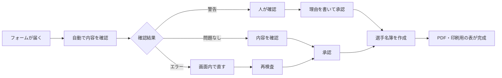
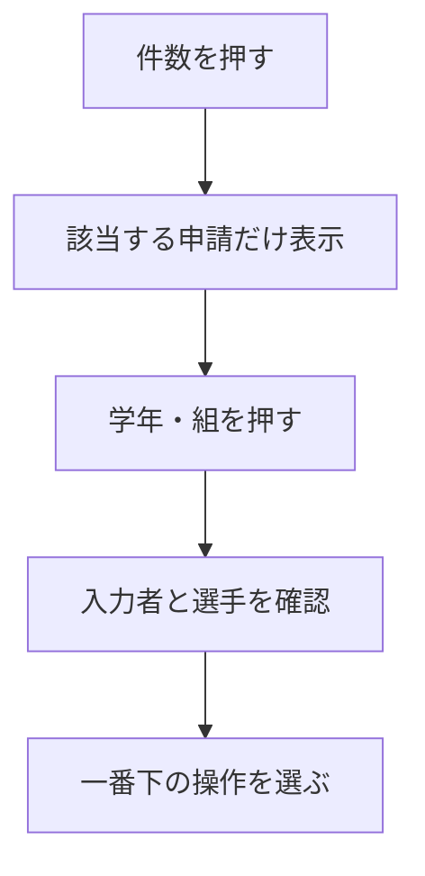
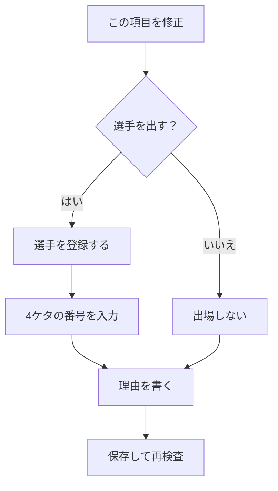
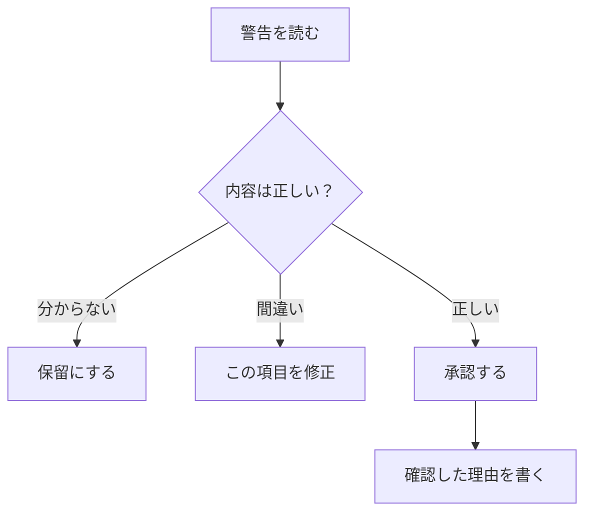
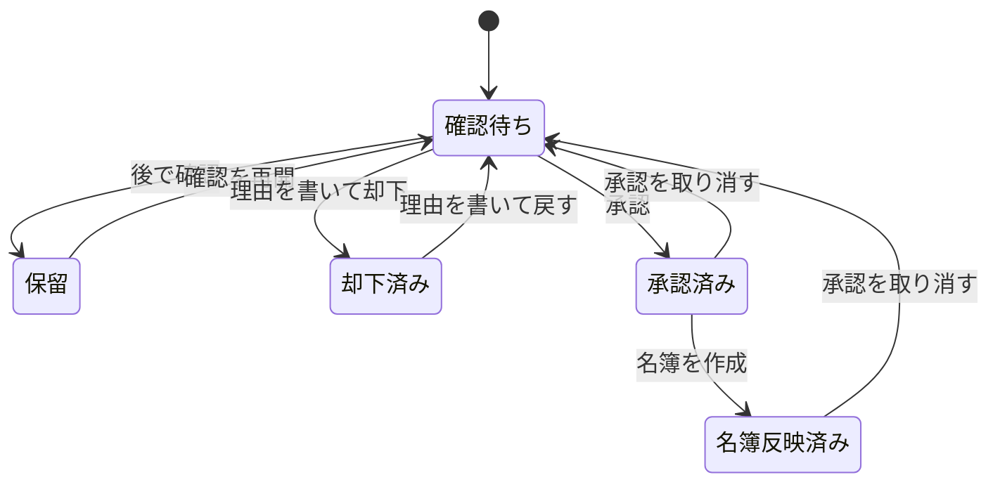
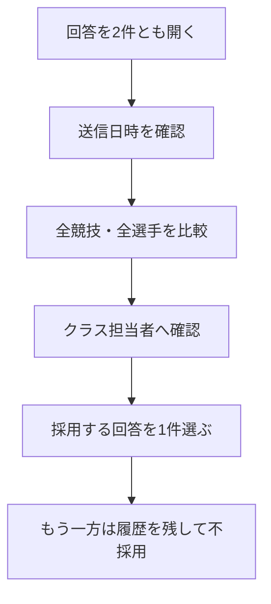
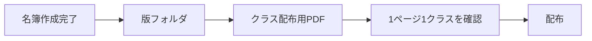
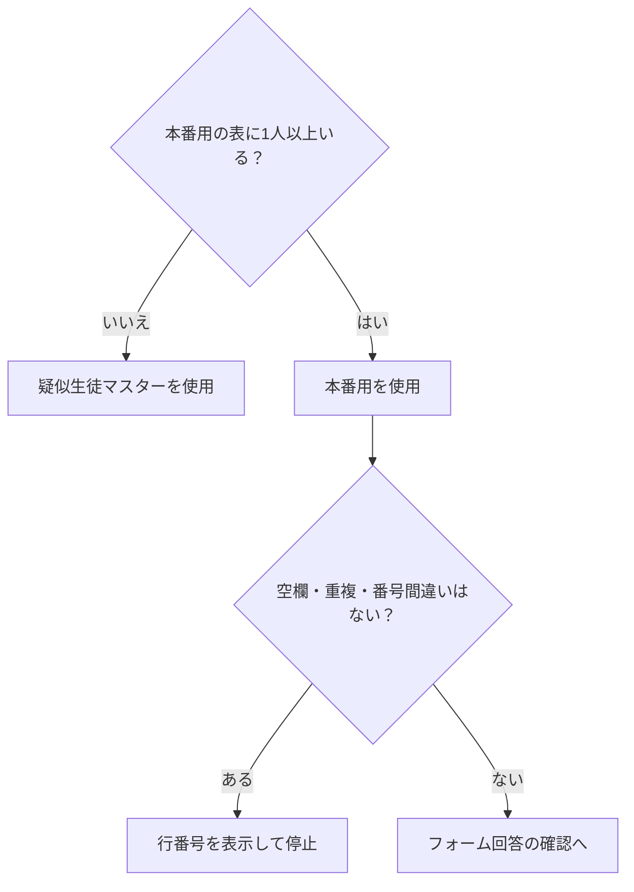
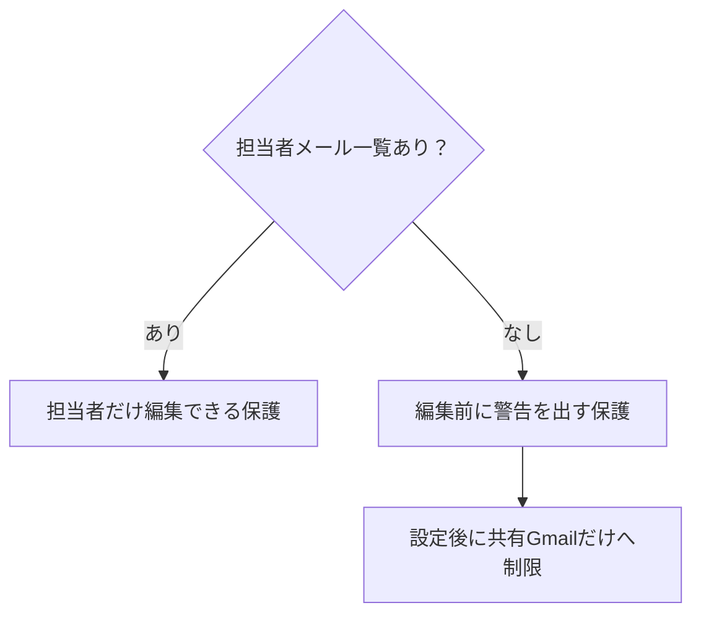
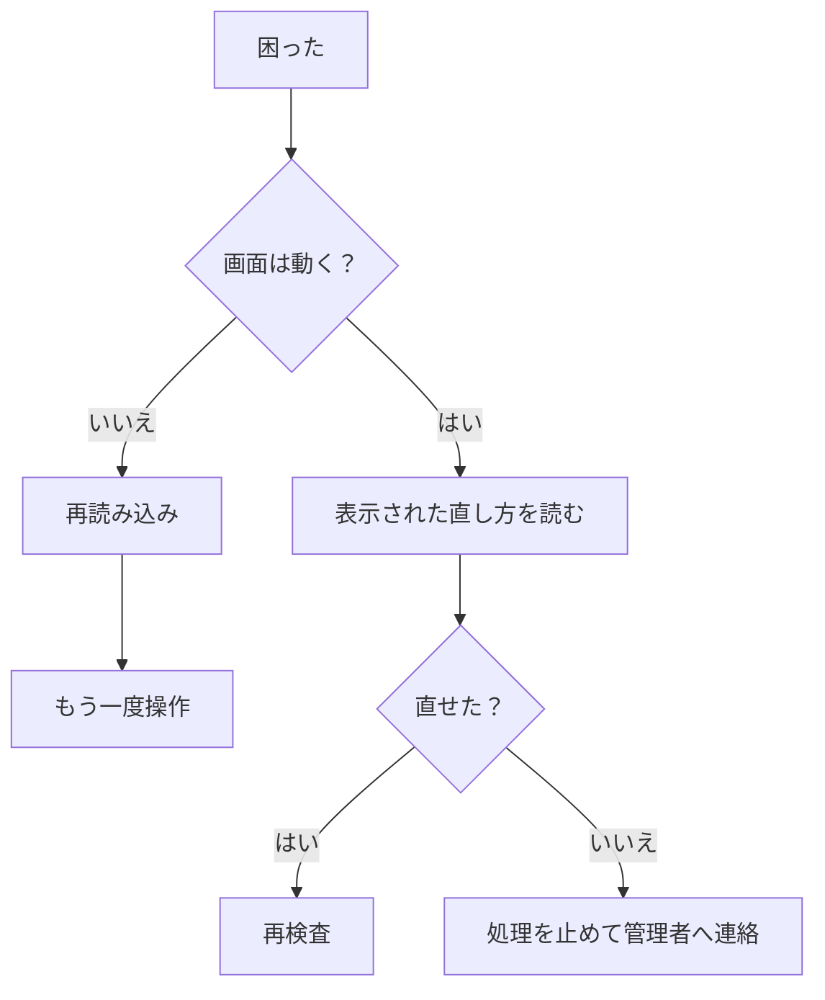

# 体育祭 選手登録管理　かんたん操作マニュアル

> 対象：パソコン操作に慣れていない担当者  
> 更新日：2026年7月19日

## 最初に覚えることは3つだけ

1. フォームが送られただけでは、配布用名簿は変わりません。
2. `エラー`は直してから、`警告`は内容を確認してから承認します。
3. 承認後に名簿作成を実行すると、配布用の表ができます。

### 本番開始後に操作を練習するとき

本番ファイルへ疑似データを入れません。`選手登録管理`メニューの`練習用コピーを作成`を押します。

1. 確認画面で`はい`を押します。
2. 表示された練習用スプレッドシートを開きます。
3. 練習用スプレッドシートでフォーム下書きを新しく作成します。
4. `開発用の疑似データを作る`で練習します。

練習用コピーには本番フォームID、生徒マスター、実回答、登録データ、履歴を引き継ぎません。練習用コピーから本番フォームを停止・削除することもできません。

### このマニュアルで使う言葉

| 言葉 | かんたんな意味 |
|---|---|
| 申請 | フォームから届いた1回分の回答 |
| 承認 | 内容が正しいと確認して、名簿作成に使える状態にすること |
| 再検査 | 入力内容をコンピューターでもう一度確認すること |
| 生徒マスター | 学籍番号、氏名、性別を確認するための元の表 |
| PDF | 印刷したり配布したりしやすい、形が崩れにくいファイル |
| 版 | 何回目に作った名簿かを表す名前 |



## 1. 申請一覧を開く

1. 管理用スプレッドシートを開きます。
2. 画面上部の`選手登録管理`を押します。
3. `申請一覧を開く`を押します。
4. 右側に`申請を確認する`が開きます。

```text
┌────────────────────────────────────┐
│ ファイル  編集  表示  …  選手登録管理 ▼ │
└────────────────────────────────────┘
                         ↓
              ┌─────────────────────┐
              │ 申請一覧を開く       │
              │ 状態別に開く         │
              │ すべて再検査する     │
              │ 承認済みから名簿作成 │
              └─────────────────────┘
```

メニューがない場合は、スプレッドシートを再読み込みします。

## 2. 件数の見方

```text
┌──────── 申請を確認する ────────┐
│ 警告 3件   エラー 1件            │
│ 問題なし 5件   保留 0件          │
│ 却下済み 1件   承認済み 10件     │
│                                  │
│ 3年8組　通常登録                 │ ← 押す
│ 警告0件　エラー0件               │
└──────────────────────────────┘
```

| 表示 | 意味 | 次にすること |
|---|---|---|
| `エラー` | このままでは登録できません | 内容を開いて直します |
| `警告` | 間違いとは限りません | 内容を人が確認します |
| `問題なし` | 自動確認では問題がありません | 内容を確認して承認します |
| `保留` | 後で確認する申請です | 確認できたら再開します |
| `却下済み` | 採用しなかった申請です | 必要なら確認待ちへ戻します |
| `承認済み` | 承認済み、または名簿へ反映済みです | 内容確認や承認取り消しができます |



## 3. エラーを直す

1. `エラー ○件`を押します。
2. 申請を押します。
3. `問題メッセージ`と`修正方法`を読みます。
4. `この項目を修正`を押します。
5. 学籍番号または登録状態を直します。
6. 修正理由を書きます。
7. `保存して再検査`を押します。

```text
┌──────────── エラー ────────────┐
│ 競技：400mリレー                 │
│ 場所：第2走者                    │
│ 問題：学籍番号が確認できません   │
│ 直し方：本人に番号を確認します   │
│       [ この項目を修正 ]         │
└───────────────────────────────┘
```



氏名は学籍番号から自動表示されます。氏名ではなく学籍番号を確認してください。

## 4. 警告を確認する

警告は、必ずしも間違いではありません。欠員が正しい場合や、別クラスの代表者が入力した場合などがあります。



理由の例：

- `欠員で正しいことをクラス担当者へ確認しました`
- `代理入力であることを3年2組の代表者へ確認しました`
- `氏名の表記だけが異なり、学籍番号と本人が一致することを確認しました`

## 5. 問題なしをまとめて承認する

`問題なし ○件をまとめて承認する`を押します。処理直前にもう一度確認され、新しく警告やエラーが見つかった申請は承認されません。

```text
┌──────────────────────────────┐
│ 問題なしの申請が5件あります   │
│ [ 問題なし 5件をまとめて承認 ]│
└──────────────────────────────┘
```

## 6. 保留・却下・元に戻す



- 判断できないときは`保留にする`を押します。
- 採用しないときは`却下する`を押し、理由を書きます。
- 却下を取り消すときは`却下済み`から開き、`確認待ちに戻す`を押します。
- 承認を取り消すときは`承認済み`から開き、`承認を取り消して確認待ちに戻す`を押します。

名簿へ反映済みの承認を取り消すと、画面上部に`配布用名簿は要再作成`と表示されます。修正、再承認、新しい名簿作成が終わるまで旧版を配布しないでください。

## 7. 同じクラスの回答が2件以上ある



`この回答を採用する`を押す前に、日時だけでなく全選手の内容を比べます。

## 8. 選手名簿を作る

1. `選手登録管理` → `承認済みから選手名簿を作成`を押します。
2. 名前を入力します。例：`第1回確認版`
3. 作成中は別の名簿作成を始めません。
4. `名簿作成の状況を確認`で進み具合を確認します。


途中で止まったら`中断した名簿作成を再開`を押します。最初からやり直す場合だけ`途中の名簿作成を取り消す`を使います。

## 9. クラス配布用PDFを確認する

1. 名簿の版フォルダを開きます。
2. `クラス配布用選手名簿.pdf`を開きます。
3. 1ページに1クラス分がまとまっていることを確認します。
4. 氏名、学籍番号、競技、走順・役割、全クラス、最終ページを確認します。
5. 黄色の行は、修正フォームから承認・反映された選手枠です。



## 10. 本番用の生徒マスターへ切り替える

1. 疑似申請を削除します。
2. `選手登録管理` → `本番用の生徒マスターを開く`を押します。
3. 黄色のA列へ4ケタの学籍番号、B列へ氏名、F列へ性別`m`または`f`を入力します。
4. 灰色の学年・組・出席番号が自動表示されたことを確認します。
5. 全員分が入っていることを人数で確認します。

```text
┌──────┬──────────┬────┬───┬────────┐
│学籍番号│氏名        │学年│ 組 │出席番号│性別│
├──────┼──────────┼────┼───┼────────┤
│ 1324 │ ○○ ○○     │ 1  │ 3 │ 24     │ m │
│ 入力  │ 入力       │ 自動│自動│ 自動   │入力│
└──────┴──────────┴────┴───┴────────┘
```



実在する氏名や学籍番号を、チャット、開発用ファイル、画面写真へ貼り付けないでください。

## 11. シートを保護する

`選手登録管理` → `システムシートの保護を設定・更新`を押します。



体育祭スタッフ共有Gmailアカウントで本番モードへ切り替え、担当者一覧も原則その1件にします。

## 12. 困ったとき

| 状況 | 対処 |
|---|---|
| メニューがない | スプレッドシートを再読み込みします |
| 画面を読み込めない | `もう一度読み込む`を押し、だめなら再読み込みします |
| 権限がない | Googleアカウントを確認し、管理者へ連絡します |
| エラーが消えない | 学籍番号を確認し、`すべて再検査する`を実行します |
| 名簿作成が止まった | 状況を確認し、`中断した名簿作成を再開`を押します |
| `配布用名簿は要再作成` | 修正・再承認し、新しい名前で名簿を作ります |
| 間違えて承認した | `承認済み`から理由を書いて確認待ちへ戻します |



## 13. 終了前チェック

- [ ] エラーが残っていない
- [ ] 警告を担当者が確認した
- [ ] 保留中の申請を確認した
- [ ] 同じクラスの複数回答を1件に決めた
- [ ] `配布用名簿は要再作成`が出ていない
- [ ] PDFの氏名、競技、最終ページを確認した
- [ ] 実在データをチャットや外部へ送っていない

## 14. 管理者へ連絡するとき

個人名や学籍番号は送らず、次だけを伝えます。

- どのボタンを押したか
- 画面に出た文章
- 何時ごろ起きたか
- 通常フォームか修正フォームか
- 何年何組か
