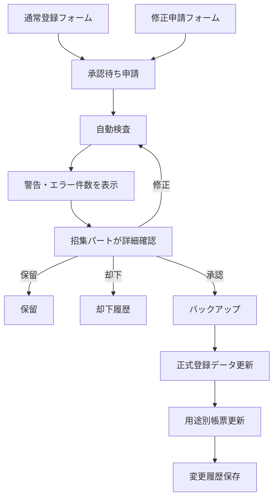

# 体育祭 選手登録・名簿管理システム 仕様書

> **ステータス**: 確定（実データ形式・競技ルール・印刷様式を除く）  
> **作成日**: 2026-07-16  
> **読者**: 実装担当者、体育祭スタッフ招集パート、担当教員

## 1. 概要

- **コンセプト**: Googleフォームから届いた選手登録・修正申請を自動検査し、招集パートが承認した場合にだけ正式名簿へ反映する。
- **利用者**: クラス代表者、体育祭スタッフ招集パート、担当教員。
- **成功条件**: PC操作に詳しくない招集担当者が、警告・エラー件数から問題箇所を開き、内容を理解して修正・承認・却下できる。フォーム送信だけでは名簿が変わらない。

過去運用では、Googleフォーム回答から名簿への手動転記、入力揺れ、修正対応の遅れが課題だった。名簿は招集時の不足・誤り対応に有用である一方、手作業負荷が大きいため、自動化と承認管理を導入する。

## 2. 仕様確定状況

| 分類 | 件数 | 内容 | 扱い |
|---|---:|---|---|
| blocker | 0 | なし | 実装開始可能 |
| assumption | 5 | 生徒マスター列、競技詳細、印刷様式等 | 設定・取込層で吸収 |
| later | 3 | 個別招集票、詳細な出場制限、通知高度化 | Phase 2 |

### 確定した前提

- フォーム回答者は各クラス代表者。
- 通常登録フォームと修正申請フォームを用意する。
- 学校Googleアカウントならフォーム回答可能。
- 回答者自身の学籍番号・氏名・メールを記録する。
- 生徒マスターを利用するが、開発時は疑似データのみ使用する。
- 開発用の疑似回答・疑似申請は、作成済みフォームの項目対応表から生成し、競技や選手枠を固定値で持たない。
- 疑似回答は現在有効な`ルール設定`の論理式をすべて読み、問題なしの疑似申請がそれらを満たすように疑似選手を割り当てる。論理式の意味はコードで解釈せず、候補の生徒を仮に入れて論理式を評価して選ぶ。
- 意図的なエラー・警告も`ルール設定`から作る。エラー申請数のぶんは`判定=エラー`のルールを、警告申請数のぶんは`判定=警告`のルールを1つずつ順番に破り、破ったあと実際に検査して、エラー申請はエラー1件以上、警告申請は警告1件以上かつエラー0件になった案だけを採用する。狙った重さにできるルールが無いときは、ルールに関係しない誤り（学籍番号の書式違反・別クラスの学籍番号・代理入力）で代用する。
- 保存前に全件検査する。満たせなかったルールや、指定した重さにならなかった申請があっても疑似データは作成し、作成後にその内容（対象クラス・競技・`rule_id｜ルール名`・論理式・そのときの集計値・直し方）を表示する。「出場しない」を選べない登録枠が1競技でクラスの人数を超えている場合だけは、物理的に埋められないため中止する。
- `欠員許可=TRUE`の競技では、まず全枠を埋め、生徒の差し替え・組み直し・入れ替えをすべて試したうえで、それでも成立しないルールが残る場合に限り、そのルールの枠を`出場しない`として空ける。重複ルールで必要人数が最大人数を超える場合だけでなく、論理式ルール全般に同じ扱いをする。空けるかどうかは全部の枠が決まった状態で判定し、割り当ての途中では空けない。競技ごとに`欠員許可によりN枠を空けています`という警告1件へまとめ、エラーにはしない。
- 開発用疑似データは対象学年、対象クラス、通常フォーム、修正フォームをチェックボックスで選択できる。通常フォームは各クラスにつき1回答だけ作る。両フォームを選んだ場合は各クラスの最初の1回答を通常フォーム、残りを修正フォームとして作る。通常フォームだけなら選択クラス数、修正フォームを含むなら選択範囲の疑似生徒数と同じ件数の疑似申請を作り、エラー申請数と警告申請数は設定シートで変更できる。
- 同じクラスに、まだ登録していない登録申請とあとから届いた修正申請が並んだ場合は、両方へ`OVERLAPPING_SUBMISSION`の警告を出し、申請確認画面で枠ごとの突き合わせ表を見せる。表には競技・枠・両方の学籍番号と氏名・登録状態を並べ、内容が違う枠と、登録申請でエラーになっている枠が分かるようにする。
- 突き合わせ表からは、選んだ枠だけ修正申請の内容を登録申請へ書き写せる。理由が必須で、変更履歴に「どの修正申請から取り込んだか」を残す。取り込まなかった枠は登録申請の内容のまま残る。これにより「登録申請でエラー → 修正フォームで申請 → 登録申請のエラーを解消して登録」が1つの申請で完結する。
- 取り込みを1回でも行った修正申請は、取り込み済みとして閉じる（却下状態＋承認履歴に取り込んだ枠数と残した枠数を記録）。開いたまま残すと、登録申請を承認したあとにその修正申請だけを承認でき、担当者が残すと決めた枠が競技ごと上書きされるため。もう一度使う場合は却下済みから確認待ちへ戻す。
- まだ登録していない登録申請が同じクラスにある間は、修正申請を単独で承認できない。まとめて承認の対象にもしない。
- すでに登録済みのクラスへ修正申請が届いた場合は、`登録データ`と修正申請の内容を同じ形式で並べて見せる。この場合の取り込みは行わず、承認するとその競技が修正申請の内容へ置き換わることを明記する。承認取消などで`登録データ`が古い可能性があるときは、その旨も表示する。
- 作成済みの疑似申請・履歴を消さず、後から修正フォームが届いた想定の疑似申請を1回1～100件追加できる。意図的なエラー・警告は付けず、現在のルールから生じる警告だけを許容する。追加IDは既存疑似回答の最大連番より後から採番し、保存失敗時は追加前へ戻す。本番用生徒マスターが有効な場合は追加しない。
- Googleフォーム作成は基本項目・学年・競技・分岐・最終切替に分割し、時間主導トリガーで自動継続する。設問はGoogle Forms APIの一括更新で競技単位に追加し、個人情報を含む生徒マスター・回答・登録データはAPIへ送信しない。完成前は現行フォームを切り替えず、中断地点からの再開と作成途中フォームの取り消しを設定画面から行える。
- フォーム設計の締切は日本標準時の日付としてカレンダーから入力し、シートとフォーム説明には曜日を自動計算した`yyyy/MM/dd(曜)`形式で表示する。
- 開発用疑似データは専用操作で削除できる。削除対象は識別可能な疑似回答と関連データに限定し、フォーム・設定・登録データ・帳票は残す。
- 本番モードへの切替は、開発用に作った申請・回答・履歴・登録データ・帳票履歴と、Googleフォームに届いているテスト回答をすべて削除してから実行する。設定と本番用生徒マスターは残す。
- 本番モードから開発用モードへ戻す操作を用意する。運用モードだけを戻し、データは削除しない。
- 本物のGoogleフォーム送信を試す前に、自動生成した疑似回答・疑似申請だけを削除し、照合用の疑似生徒マスターを残す切替操作を管理画面に置く。実在の個人情報は使用しない。
- 学籍番号は4桁。先頭2桁が学年・組、後半2桁が番号。
- 学年1〜3、組1〜8。人数は39〜41人等の例外を許容する。
- 有効な生徒かは生徒マスター存在確認で判定する。この判定はルール設定の行の有無にかかわらず常に行われる。
- 競技の各枠は学籍番号のみを入力し、氏名は生徒マスターから照合して表示する。氏名欄があった頃の旧回答・手入力での氏名差異は警告にとどめる。
- 招集パート全員が承認・却下・保留・修正できる。
- 帳票は用途別に独立ファイルとする。
- 選手の修正は修正フォームから申請し、理由・承認履歴を記録する。帳票からの選手変更UIは設けない。
- すべてのフォーム送信は承認待ちとなり、自動反映しない。

## 3. 全体フロー



## 4. MVP機能

### 4.1 競技設定とフォーム生成

- **目的**: 毎年の競技変更をコード修正なしで反映する。
- **入力**: 競技ID、競技名、対象学年、区分、必要人数、走順、欠員可否、表示順。
- **処理**: 設定から通常登録フォームと修正申請フォームを生成・更新する。
- **出力**: 2種類のGoogleフォーム。
- **権限**: 招集パート、担当教員。

受け入れ条件:

- [x] 学年1〜3の分岐が作られる。
- [x] 必要人数分の学籍番号入力欄が生成される。選手枠の氏名入力欄は生成しない。
- [x] 入力者と全選手の学籍番号欄で半角数字4桁を検証し、「4ケタの学籍番号を数値で入力してください」と表示する。
- [x] フォーム説明に「送信だけでは名簿へ反映されない」と表示する。
- [x] フォーム説明と各競技の説明に「学籍番号（半角数字4桁）だけを入力します。氏名は名簿から自動で照合します。送信前に番号を確認してください」という趣旨の文言を表示する。
- [x] 設定に不備がある場合、対象行と直し方を表示して生成を中止する。
- [x] 競技の必要人数合計が生徒マスター人数より多い場合、超過人数を警告し、複数競技参加か設定誤りかを確認できる。
- [x] ルール対象を有効な競技設定から生成し、チェックボックスで複数競技を選択できる。
- [x] 競技名変更時も`event_id`が同じならルールの選択状態を保持する。

### 4.2 フォーム回答受付

- **目的**: 回答を安全に保存し、正式反映から分離する。
- **入力**: 通常登録または修正申請。
- **処理**: 申請ID付与、回答保存、自動検査、承認待ち登録。
- **出力**: 承認待ち申請、警告・エラー。
- **権限**: 回答は学校アカウント、管理は招集パート・教員。

受け入れ条件:

- [x] 送信後に正式登録データと帳票が変更されない。
- [x] 同一クラスから複数回答があっても自動採用しない。
- [x] 受付停止中の修正申請は保留として保存される。
- [x] 回答者の学籍番号・氏名・メール・対象クラスが記録される。
- [x] 処理失敗時も回答原本が失われない。
- [x] 全申請の再検査、ルール変更の確定、名簿作成、疑似データ作成の実行中に届いた回答を、古い内容の書き戻しで消さない。取込はこれらの処理が終わるまで待ち、待ちきれない場合はエラーとして回答をフォーム側に残し、`回答取込を点検・再処理`で取り込める状態にする。

### 4.3 生徒マスター照合

- **目的**: 学籍番号の誤りを検出し、氏名は生徒マスターから照合して表示する。
- **入力**: 申請内の学籍番号（氏名欄があった頃の旧回答では氏名も含む）、対象クラス、生徒マスター。
- **処理**: 正規化、存在確認、所属確認、氏名比較（氏名入力のある回答だけ）。
- **出力**: エラーまたは警告。

受け入れ条件:

- [x] 生徒マスターにない学籍番号は警告になる。この判定はルール設定に依存せず、ルール行を削除・無効化しても常に行われる。転入直後などで生徒マスターへ未登録の生徒が稀にいるため、エラーにしてクラス全体の承認を止めることはしない。警告なので承認者の判断で承認でき、自動一括承認の対象にはならない。警告のまま名簿を作成した場合、その枠の氏名は`（名簿未登録）`と印字され、性別は`UNKNOWN`になる。厳格に禁止したい場合は`ルール設定`へ判定エラーの`INVALID_ID == 0`を追加する。
- [x] 対象クラスと所属が異なる場合はエラーになる。この判定もルール設定に依存せず常に行われる。学年・組（上2桁）の不一致で検出できる。同じクラス内での出席番号（下2桁）の打ち間違いは自動検出できないため、承認画面に表示される「名簿の氏名」を承認者が確認する。
- [x] 氏名の表記差異は`ルール設定`のR002（既定で有効、論理式`NAME_MISMATCH == 0`、氏名入力のある回答（氏名欄があった頃の旧回答・手入力）だけが対象）が満たされない場合に警告になる。R002を無効にすると氏名差異は表示されない。学籍番号のみの回答では氏名照合の対象件数は常に0件になり、警告は発生しない。
- [x] 入力者の所属と登録対象クラスが異なる場合だけ代理入力警告になり、同じ場合は警告しない。
- [x] 未出場者は人数を全体警告1件へまとめ、該当生徒のクラス・学籍番号・氏名を一覧表示する。
- [x] 同じ競技内での同じ選手の重複登録は`ルール設定`の論理式ルール（既定でR001、論理式`MAX_PER_EVENT <= 1`）が満たされない場合にエラーまたは警告として表示される。競技をまたいだ出場数は`MAX_PER_STUDENT`で判定する。該当ルールが判定に使った競技の登録内容を一覧表示し、各行から個別に修正できる。重複を禁止するルールが設定・有効化されていなければ重複は検出されない。
- [x] 重複を検出した論理式ルールの一覧では、各登録を管理画面から個別に修正できる。重複している行には`重複A`の目印と、その競技で同じ生徒が何回登録されているかを表示する。
- [x] 本番用`生徒マスター`では学籍番号、氏名、性別m/fを入力し、学年・組・出席番号を4桁番号から自動生成する。
- [x] 性別m/fを内部のM/Fへ正規化し、論理式ルールの人数変数へ使用する。
- [x] 本番用マスターに入力があれば優先し、全行空欄の場合だけ疑似マスターを使用する。入力不足・番号不正・重複時は疑似マスターへ戻さず処理を止める。
- [x] 半角・全角・改行・タブ・ゼロ幅空白と全角半角だけの氏名差異は自動正規化される。
- [x] 39人、40人、41人、欠番のあるクラスを処理できる。

### 4.4 警告・エラーダッシュボード

- **目的**: PC操作に不慣れな利用者でも問題件数と修正箇所を把握する。
- **入力**: 未処理申請と検査結果。
- **処理**: 件数集計、絞り込み、詳細表示。
- **出力**: `警告○件`、`エラー○件`ボタンと詳細カード。

受け入れ条件:

- [x] 操作画面に`警告 N件`と`エラー N件`が常に表示される。
- [x] 操作画面に`承認済み N件`を表示し、承認済みと名簿反映済みの申請を一覧で確認できる。
- [x] 件数を押すと該当する未処理項目だけが表示される。
- [x] 詳細に問題箇所、現在値、修正方法、操作ボタンが表示される。
- [x] 申請詳細に`登録内容の一覧`を置き、申請の全選手枠を競技ごとに並べる。エラーのある枠は赤、警告のある枠は黄色の線と`エラー N`・`警告 N`の目印で強調する。目印の番号は上の検査結果カードの見出し番号と一致させる。
- [x] 検査結果カードの`該当箇所を表示`を押すと、`登録内容の一覧`が開き、該当する枠または競技へ画面が移動して一定時間だけ枠が強調される。枠を特定できない申請全体の内容には、このボタンを表示しない。
- [x] 1件で複数の枠を指す検査結果（欠員警告など）は、対象の全枠を強調し、カードの`競技`と`場所`にも実際の競技名と枠名を表示する。
- [x] 申請詳細に`同じ生徒の重なりを確認する`を置き、同じ競技の中で同じ生徒が複数の枠に入っている組を`重複A`のような目印付きで表示する。学籍番号、名簿の氏名、性別、登録されている枠名を並べ、`該当箇所を表示`で一覧の該当枠へ移動できる。
- [x] 同じ競技内の重複が1件もない場合は、その旨を1行で表示する。
- [x] 競技をまたいだ出場は重複として扱わず、`複数の競技に出場する生徒`の折りたたみへ出場競技数と枠を中立に表示する。
- [x] 同じ生徒の判定は学籍番号だけで行い、同姓同名の別生徒はまとめない。`重複A`の数え方は論理式`MAX_PER_EVENT`、`複数の競技に出場する生徒`の数え方は`MAX_PER_STUDENT`と一致させる。
- [x] 重なりの表示は事実だけを示し、良し悪しの判定は行わない。禁止するかどうかは`ルール設定`の論理式が決め、違反時だけエラーまたは警告のカードに表示される。
- [x] 通常登録の詳細に、自分のクラスの入力か別クラスの代理入力かを表示する。
- [x] 修正申請の詳細に、申請理由と変更内容を表示する。
- [x] 選手枠の詳細に「名簿の氏名：（生徒マスターから引いた氏名）」を表示する。名簿に無い学籍番号のときは「名簿で確認できません」と表示する。
- [x] エラーがある申請では承認ボタンを無効化する。
- [x] 警告だけの申請は確認後に承認できる。
- [x] 警告付き申請の承認時は理由を必須入力とし、承認履歴へ保存する。
- [x] 承認済み申請は理由付きで承認を取り消し、再検査して確認待ちへ戻せる。名簿反映済みの場合は、名簿作成中でないことを確認し、残りの反映済み申請から登録データを再構築する。作成済みPDFは旧版として保持する。
- [x] 内部用専門語を画面に表示しない。
- [x] 出場登録のない生徒がいる場合、人数を含む全体警告を1件だけ表示する。
- [x] 全体警告を押した後、意味と確認方法を申請警告とは別のカードで表示する。

### 4.5 修正・承認・保留・却下

- **目的**: 人間の判断を経て正式データへ反映する。
- **入力**: 申請、修正内容、理由、操作。
- **処理**: 再検査、履歴記録、状態変更。
- **出力**: 承認済み、保留、却下、重複回答の採用・不採用。

受け入れ条件:

- [x] `AUTHORIZED_EDITOR_EMAILS`に登録した招集担当者全員が操作でき、未設定環境では通常のスプレッドシート編集者として操作できる。
- [x] エラー0件の場合だけ承認できる。
- [x] 修正・却下では理由入力が必須になる。
- [x] 申請者、承認者、日時、変更前後、理由が記録される。
- [x] 同じ操作を連続実行しても二重処理されない。
- [x] 同じクラスの複数回答は内容と送信日時を並べ、採用する1件を選べる。
- [x] 採用前は重複回答のどちらも承認できず、採用・不採用の履歴が残る。
- [x] 警告0件・エラー0件の承認待ち申請だけを、再検査後に一括承認できる。
- [x] 一括承認した各申請に承認者・日時・操作内容を記録し、途中失敗時は元へ戻す。
- [x] 却下済み申請を専用一覧から開き、理由付きで有効な確認状態へ戻せる。
- [x] 却下を取り消すと現在の入力内容を再検査し、結果に応じて確認待ち・修正必要・保留へ戻す。
- [x] 元の却下理由と、復帰操作の実行者・理由・日時を履歴へ残す。
- [x] `AUTHORIZED_EDITOR_EMAILS`または`ALLOWED_DOMAIN`設定時、権限のないアカウントは操作できない。

### 4.6 正式データ反映と帳票更新

- **目的**: 承認済み内容を正本と用途別帳票へ整合的に反映する。
- **入力**: 承認済み申請。
- **処理**: バックアップ、正式データ更新、影響帳票特定、差分反映、履歴保存。
- **出力**: 更新済み正式データ、3種類のスプレッドシート帳票、1ページ1クラスの配布用PDF。

対象帳票:

- 種目別
- クラス別・招集順（1ファイルに統合）
- 当日変更用

受け入れ条件:

- [x] 承認前は帳票が変わらない。
- [x] 名簿作成時に更新前の`登録データ`バックアップを作成する。
- [x] 作成のたびに名前を必須入力し、`v1.0`から同名の空き版番号へ自動採番する。
- [x] 管理スプレッドシートと同じ場所の`選手名簿`フォルダ内へ、版フォルダと3つの独立ファイルを作成する。
- [x] 3種類のスプレッドシートと配布用PDFを別実行で1つずつ作成し、時間切れ後は未完了ファイルから再開できる。
- [x] 作成中の二重開始を拒否し、取り消し時は途中フォルダを削除して正式データを変更しない。
- [x] 全ファイル完成後の最終処理でだけ`登録データ`と申請状態を更新する。
- [x] 一度名簿を作ったあとは、`変更点だけを反映して選手名簿を作成`で前回の版のファイルを複製し、変わった選手枠を含むページだけを書き直した新しい版を作れる。
- [x] 差分作成の版名は前回と同じ名前を引き継ぎ、名前を入力せずに版番号だけが進む（`確認版_v1.0`のあとは`確認版_v1.1`）。
- [x] 差分作成の比較元は複製したファイルの`_管理用データ`シートとし、`登録データ`は使わない。承認取消のあとに`登録データ`が作り直されても、すでに配った帳票との差分が正しく出る。
- [x] 学籍番号が同じでも、生徒マスターの氏名・性別が変わった選手枠は差分に含める。
- [x] 前回の版から変わった選手枠が0件のときは差分作成を実行せず、その旨を表示する。
- [x] 前回の版のフォルダ・ファイル・`_管理用データ`が無い、競技設定が変わってページの対応が取れない、書き直すページが全体の3分の2以上になる、のいずれかではそのファイルだけ全面作成へ切り替える。処理は止めない。
- [x] クラス配布用PDFは差分にできないため毎回作り直す。
- [x] 前回の版のファイルを複製するため、書き直さないシートには当日変更用の記入欄・確認欄への書き込みが残る。書き直したシートだけが空欄に戻る。これは意図した引き継ぎで、消す処理は行わない。
- [x] 差分作成でも、最終処理（バックアップ、`登録データ`の入れ替え、承認済み申請の反映済み化）は通常の名簿作成とまったく同じ手順で行う。
- [x] 差分作成では、変わった選手枠を含むシートと`自分の競技を探す`索引だけを書き直す。書き直さないシートは見出しの版名と作成日時だけをそろえる。帳票のファイル自体は毎回4つとも作る。
- [ ] 更新箇所が視覚的に強調される。
- [ ] 変更箇所から変更理由・変更履歴を確認できる。
- [x] 更新失敗時に`登録データ`と申請状態を戻し、作成途中の版フォルダを破棄する。

### 4.7 修正フォームからの変更

- **目的**: 人間による変更を正式データへ安全に戻す。
- **入力**: 対象行、変更後選手、理由、詳細。
- **処理**: 手動変更申請として保存、自動検査、承認待ち化。
- **出力**: 承認待ち申請。

受け入れ条件:

- [x] システムシートは、担当者一覧設定時は厳格保護、未設定環境では通常操作を妨げない編集警告で保護する。
- [ ] `選手を変更する`操作からのみ変更できる。
- [x] 修正フォームでは変更理由と変更対象競技を必須にする。
- [x] 修正フォームのページは、`競技設定`の`表示順`を100ごとに区切ったまとまり（セクション）で作る。`表示順`0・100・200は別のセクション、100・101・102・103は同じセクションになる。`修正する競技`ではセクションを1つ選び、そのセクションに含まれる全競技の登録選手をすべて入力する。セクション名は同じセクションの競技名の共通部分（「棒引き 1~4回戦チーム1」等から「棒引き」）を使い、共通部分がない場合は「先頭の競技名 ほか◯競技」とする。
- [x] 同じセクションの競技は`ルール設定`の判定でも1件の申請としてまとめて検査されるため、`MAX_PER_STUDENT`などの出場数上限が修正申請でも働く。セクションをまたぐ上限は、修正申請では判定できない。
- [x] 修正フォーム送信直後には正式データ・帳票を変更しない。
- [x] 承認後に作成した新しい帳票版で、修正フォーム由来の選手枠を黄色で強調する。

### 4.8 PDF・人間編集

- **目的**: 完成後の名簿を学校運用で扱いやすくする。
- **入力**: 各帳票。
- **処理**: 印刷範囲、改ページ、PDF生成。
- **出力**: PDFまたは編集可能なGoogle Sheets。

受け入れ条件:

- [x] 各帳票を独立ファイルとして開ける。
- [x] 全ファイルの先頭に、選手氏名から全競技・走順を確認できる配布用索引を付ける。
- [x] 全帳票に競技名、走順・役割、クラス、学籍番号、選手氏名を人向けの日本語で表示する。
- [x] 各帳票を学年別シートに分け、競技ごとに縦を走順・役割、横をクラスとした表で表示する。
- [x] 同じ走順の選手をクラスごとに横並びにし、同じクラス・同じ走順の複数人は同じセルにまとめる。
- [x] 競技設定にある全競技・全枠を表示し、未登録の枠は名簿から消さず空欄で残す。
- [x] 種目別、クラス別・招集順の統合版、当日変更用を出力し、走順別ファイルは作成しない。
- [x] 種目別名簿は`表示順`の100区切りでシート（ページ）を分ける。表示順0・100・200はそれぞれ別のシートになり、300・301・302は1枚のシートへまとまる。学年ごとに競技を細かく分けている場合に、1枚へまとめて印刷できるようにするための区切り。
- [x] 1競技だけのページは、同じシート内へ対象学年の表を1年から順に縦へ並べ、見出しを`1年`のように学年だけにする。
- [x] 複数競技をまとめたページは、競技を表示順（同じなら招集順）に上から並べ、見出しへ競技名を入れる。全学年対象の競技は`競技名（1年）`のように学年も併記する。
- [x] ページのシート名は、1競技ならその競技名、複数なら競技名を`・`で連ねたもの。長くなりすぎる場合は`先頭の競技名ほかN件`にする。
- [x] 統合版はクラス別1〜3年と招集順1〜3年のシートを1ファイルに収録する。
- [x] 当日変更用は種目別と同じ競技別シート・走順×クラス形式で出力し、変更記入欄を付ける。
- [x] タイトル、説明、版、作成日時、固定見出し、罫線、帯色、折り返し、列幅を印刷・PDF配布向けに設定する。
- [ ] 備考・当日メモ等の人間編集列は帳票再同期で消えない。
- [x] 未処理の警告・エラー・変更申請がある場合、PDF出力前に注意表示する。
- [x] クラス配布用PDFは1ページに1クラス分の全登録をまとめて自動生成する。

### 4.9 運用モードの切替

- **目的**: 開発用モードと本番モードを行き来できるようにし、本番開始時に開発用データを残さない。
- **入力**: 運用モード（`システム設定`シートと`SYSTEM_MODE`）、本番用`生徒マスター`、開発用に作成した申請・履歴・帳票データ、作成済みGoogleフォーム。
- **処理**: 切替前の点検、開発用データの一括削除、運用モードの書き換え、設定変更履歴への記録。
- **出力**: 切替結果と削除件数、手動で片付ける帳票フォルダのURL。

受け入れ条件:

- [x] 本番モードへの切替前に、削除するもの（承認待ち、申請項目、検査結果、承認履歴、変更履歴、フォーム回答原本、登録データ、疑似生徒マスター、疑似データ設定、実機テスト、選手名簿作成履歴、名簿作成状況、Googleフォームに届いている回答）と残すもの（本番用生徒マスター、競技設定、ルール設定、フォーム設計、フォーム項目対応表、設定変更履歴、Googleフォーム本体）を件数付きで表示する。
- [x] 確認欄に`本番開始`と入力した場合だけ切り替える。入力が違えば何も削除せず中止する。
- [x] 削除は運用モードの書き換えより先に実行し、削除で失敗した場合は開発用モードのまま残す。
- [x] 本番用`生徒マスター`が空、入力不足・番号不正・重複がある、共有範囲が広い、名簿作成が実行中、フォームが公開前確認中のいずれかであれば切り替えず、理由を表示する。
- [x] 公開前確認中の旧フォームIDが残っている場合も、そのフォームの回答を削除対象に含める。
- [x] 切替後に「回答取込を点検・再処理」を実行しても、開発中のテスト回答は取り込まれない。
- [x] 開発中に作った選手名簿のDriveフォルダは自動削除せず、URLを表示して手動削除を促す。
- [x] 本番モードから`開発用モードへ戻す`を実行でき、理由を入力すると設定変更履歴へ記録される。申請・登録データ・履歴・フォームは削除しない。
- [x] 開発用モードへ戻した後は、`システム設定`シートとScript Propertyの両方が開発用となり、再読み込みで開発用メニューへ戻る。
- [x] 開発用モードへ戻した後、疑似申請に使う名簿がどちらかを画面に明記する。本番用`生徒マスター`に入力があっても疑似データ機能は使える。
- [x] 練習用コピーでは本番モードへの切替も開発用モードへの切替も実行できない。

### 4.10 疑似申請に使う名簿の選択（開発用モード限定）

- **目的**: 本番用`生徒マスター`へ実在の生徒を入力したあとも、開発用モードなら疑似データで動作確認を続けられるようにする。
- **入力**: 運用モード、`疑似データ設定`シートの`疑似申請に使う名簿`、`疑似生徒マスター`、`生徒マスター`。
- **処理**: 名簿の解決、疑似申請の生成、作成時の名簿の記録、消費時の食い違い検出。
- **出力**: 疑似申請と、作成に使った名簿の記録。

受け入れ条件:

- [ ] `疑似データ設定`シートに`疑似申請に使う名簿`行があり、`疑似生徒マスター`と`生徒マスター`をプルダウンで選べる。既定は`疑似生徒マスター`。
- [ ] 本番用`生徒マスター`に入力があっても、開発用モードなら疑似データの作成・追加・削除をすべて実行できる。
- [ ] 本番モードでは、名簿の選択に関係なく疑似データ機能を実行できない。ボタンの非表示だけでなくサーバー側で中止する。
- [ ] 2つの名簿を結合しない。検査・確認画面・名簿作成は常にどちらか一方だけを参照する。
- [ ] `疑似生徒マスター`を選んだとき、`生徒マスター`に入力があっても疑似申請は疑似生徒で作られる。
- [ ] `生徒マスター`を選んだとき、`疑似生徒マスター`シートへは一切書き込まない。実在の生徒で疑似申請だけを作る。
- [ ] どちらを選んでも、疑似データが本番用`生徒マスター`シートへ書き込まれることはない。
- [ ] 疑似データの確認ダイアログに、今回使う名簿名を表示する。`生徒マスター`を選んだ場合は、実在の氏名が`承認待ち`『申請項目』『検査結果』『フォーム回答原本』へ入ることと、削除で消えることを明記する。
- [ ] 疑似申請を作ったときの名簿を`疑似データ設定`の`疑似申請を作成した名簿`へ自動記録する。この行は編集させない。
- [ ] 疑似申請が残ったまま名簿の選択を変えた場合、全再検査・部分再検査・疑似修正申請の追加・承認・選手名簿作成のいずれも実行せず、作成時の名簿へ戻すか疑似データを削除するよう案内する。
- [ ] 疑似データをすべて削除すると、`疑似申請を作成した名簿`の記録も消える。
- [ ] 本番モードへの切替前の入力検証は、名簿の選択を通さず本番用`生徒マスター`だけを検証する。
- [ ] 選んだ名簿が空のとき、どちらの名簿が空なのかが分かる文言で中止する。

### 4.11 機能カタログと機能紹介

- **目的**: 増えた機能の全体像を1か所で見られるようにし、説明が実装より古くなることを仕組みで防ぐ。
- **入力**: `src/core/feature-catalog.ts`、運用モード、各機能の前提条件。
- **処理**: 表示可否と実行可否の評価、メニュー構築、説明枠の描画、一覧の生成。
- **出力**: メニュー、サイドバーの説明枠と無効化理由、機能紹介ダイアログ。

受け入れ条件:

- [ ] すべての利用者向け操作が`FEATURE_CATALOG`に1件ずつあり、表示名・何をする・作るもの・変えないもの・いつ使うかを持つ。
- [ ] `src/main.ts`の`export function`のうちカタログに無いものは、`NON_FEATURE_ENTRYPOINTS`へ理由付きで書かれている。理由の無い関数は許さない。
- [ ] `src/main.ts`へ関数を足してカタログにも除外表にも書かなかった場合、`npm test`が落ちる。
- [ ] カタログや除外表が、存在しない関数を指している場合も`npm test`が落ちる。
- [ ] 画面のHTMLが、存在しないサーバー関数を呼んでいる場合も`npm test`が落ちる。
- [ ] 抽出に使う正規表現は`scripts/extract-entrypoints.mjs`の1か所だけにあり、ビルドとテストの両方がそれを読む。
- [ ] 運用モードで決まる機能はメニューにもサイドバーにも出さない。状態で決まる機能は表示したまま押せなくし、理由を1行添える。
- [ ] `onOpen`では設定の点検など重い処理を実行しない。
- [ ] メニューから状態依存の機能を実行した場合、処理を始める前に「先に◯◯をしてください」を表示して中止する。
- [ ] 機能紹介ダイアログを開くと、分類ごとに現在使える機能が並び、使えない機能は理由付きで表示される。本番モードでは開発用の機能が一覧に出ない。
- [ ] 機能紹介ダイアログに実行ボタンを置かない。

## 5. エラー・警告表示仕様

表示順:

1. `警告 N件` / `エラー N件`
2. 問題箇所
3. 問題内容
4. 入力内容
5. 修正方法
6. 操作ボタン

例:

```text
エラー 1
場所：2年3組 男子100m走 第2走者
問題：学籍番号の書き方を確認してください。
入力内容：239

修正方法：
1. 選手本人の学籍番号を確認してください。
2. 半角数字4桁で入力してください。
3. 「修正する」を押して正しい番号を入力してください。

[修正する] [該当箇所を開く]
```

詳細は[ui.md](ui.md)。

## 6. 非機能要件

| 項目 | 要件 |
|---|---|
| セキュリティ | 体育祭スタッフ共有Gmailアカウントを所有者・実行者に統一。公開Webアプリ禁止。外部通信は個人情報を含まないフォーム設問作成用Google Forms APIだけ許可 |
| 個人情報 | 実データをLLM・リポジトリ・一般ログへ出さない |
| 操作性 | 主要操作は操作画面とダイアログから実施。Apps Scriptエディタを開かせない |
| 信頼性 | フォーム送信と正式反映を分離。反映前バックアップ必須。申請・項目・検査結果を書き換える処理はすべてドキュメントロックの中で実行し、同時に届いた回答を上書きしない |
| 監査 | 申請者、承認者、変更前後、理由、日時を記録 |
| 保守性 | 年度・競技変更を設定シートで行い、通常運用でコード編集不要 |
| 対応環境 | 学校で利用する最新Chromeを主対象 |

## 7. 検証戦略

| 対象 | 検証 |
|---|---|
| 学籍番号形式・氏名正規化 | 純関数の自動テスト |
| 生徒存在・所属判定 | 疑似生徒マスターによる自動テスト |
| 重複回答・人数不足 | 疑似フォーム回答による自動テスト |
| 件数ボタンと詳細絞り込み | テスト用スプレッドシートで手動確認 |
| 承認前に名簿が変わらない | 前後スナップショット比較 |
| 承認後の5帳票整合 | 登録ID単位の自動比較 |
| 権限不足 | 許可外テストアカウントで操作確認 |
| ロールバック | 意図的例外による復旧テスト |
| PDF | 疑似データから自動生成したクラス配布用PDFを表示し、1ページ1クラス、氏名、競技、走順、文字サイズを目視確認 |
| フォーム送信から取込・検査までの経路 | 実機テスト。本物のGoogleフォームへ回答を投入し、取り込まれた申請・検査結果が同じ入力に対する検査結果と一致するかを照合する |

### 完了の定義

- [ ] 全受け入れ条件が○
- [x] 自動テスト、Lint、型検査、ビルドが成功
- [x] 実在個人情報を使用せずローカル自動検証完了
- [x] 本番運用中も、本番フォームと実データを切り離した練習用コピーで疑似データを使用できる
- [ ] 操作説明をPC初心者が読んで実行できる
- [x] docsを現在の実装内容へ更新

## 8. 実装タスク

- [x] GASプロジェクト・テスト基盤作成
- [x] 疑似生徒マスター生成
- [x] 設定シートと列対応設定
- [x] 通常登録フォームの下書き生成
- [x] 修正申請フォームの下書き生成
- [x] フォーム回答取込と申請保存
- [x] 検査エンジン
- [x] 操作画面と件数ボタン
- [x] 申請詳細ダイアログまたはサイドバー
- [x] 保留・却下・承認・修正箇所への移動
- [x] エラー・警告・重複箇所のハイライトと該当箇所への移動
- [x] 管理者による申請内容の修正と再検査
- [x] 申請確認画面の各選手枠へ、生徒マスターから引いた性別（`男（M）`・`女（F）`・`UNKNOWN`）を表示する。
- [x] 3種類の選手名簿・クラス配布用PDF・`自分の競技を探す`索引へ、名簿作成時点の性別（`男`・`女`・`UNKNOWN`）を表示する。
- [x] バックアップ・ロールバック
- [x] 3種類の帳票生成
- [x] 帳票からの選手変更UIは採用しない
- [x] クラス配布用PDF出力
- [x] 管理スプレッドシートと選手名簿の権限・共有設定検査
- [x] PC初心者向けの図入り操作マニュアル
- [ ] 第三者による引継ぎ試験

### 8.1 フォーム保守性・設定画面の差分

設定シートを正本とし、Googleフォームを年度ごとの派生物として扱う。設定点検、下書き生成、`field_key`対応表、公開確定前の構造点検、公開設定の編集防止、理由付き設定変更履歴まで実装する。`ルール設定`はフォームの設問構成に影響しないため、フォーム公開後も受付を止めずフォームを作り直さずに変更でき、確定時に受信済みの全申請を新しいルールで再検査する。年度コピーは次段階とする。詳細と受け入れ条件は[settings.md](settings.md)を参照する。

## 9. 未決定事項

### assumption

- [x] 本番用`生徒マスター`は`student_id`、`name`、`gender_m_or_f`を入力し、学年・組・出席番号を自動生成する固定構成とする。
- [x] 競技別必要人数・区分・招集順は設定シートへ入力できる。
- [ ] PDFレイアウトは実際の名簿様式確認後に調整する。
- [x] 体育祭スタッフ共有Gmailアカウントを所有者・実行者に統一し、本番モードの担当者一覧で制限する。

### later

- [ ] 選手一人ずつの個別招集票
- [x] 許可変数を使った論理式がTRUEなら通過、FALSEなら指定したエラー・警告にする出場制限ルール
- [ ] 高度な通知・集計ダッシュボード

### 解消済み blocker

- [x] フォーム回答者はクラス代表者。
- [x] フォーム送信では自動反映しない。
- [x] 招集パート全員が承認できる。
- [x] 氏名差異（氏名欄があった頃の旧回答が対象）は警告、学籍番号不正はエラー。
- [x] 同一クラス複数回答は人間が採用判断する。
- [x] 修正フォームは常設し、受付停止中は保留する。
- [x] 帳票は用途別に独立ファイルとする。
- [x] 選手変更は修正フォームと理由記録を必須とし、帳票変更UIは設けない。
