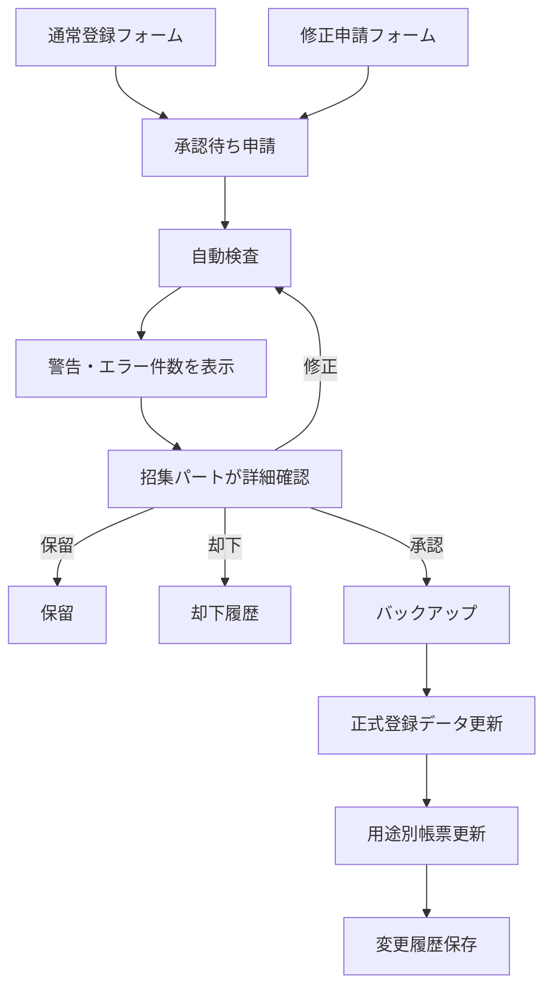

# 体育祭 選手登録・名簿管理システム 仕様書

> **ステータス**: 確定（実データ形式・競技ルール・印刷様式を除く）  
> **作成日**: 2026-07-16  
> **読者**: 実装担当者、体育祭スタッフ招集パート、担当教員

## 1. 概要

- **コンセプト**: Googleフォームから届いた選手登録・修正申請を自動検査し、招集パートが承認した場合にだけ正式名簿へ反映する。
- **利用者**: クラス代表者、体育祭スタッフ招集パート、担当教員。
- **成功条件**: PC操作に詳しくない招集担当者が、警告・エラー件数から問題箇所を開き、内容を理解して修正・承認・却下できる。フォーム送信だけでは名簿が変わらない。

過去運用では、Googleフォーム回答から名簿への手動転記、入力揺れ、修正対応の遅れが課題だった。名簿は招集時の不足・誤り対応に有用である一方、手作業負荷が大きいため、自動化と承認管理を導入する。

## 2. 仕様確定状況

| 分類 | 件数 | 内容 | 扱い |
|---|---:|---|---|
| blocker | 0 | なし | 実装開始可能 |
| assumption | 5 | 生徒マスター列、競技詳細、印刷様式等 | 設定・取込層で吸収 |
| later | 3 | 個別招集票、詳細な出場制限、通知高度化 | Phase 2 |

### 確定した前提

- フォーム回答者は各クラス代表者。
- 通常登録フォームと修正申請フォームを用意する。
- 学校Googleアカウントならフォーム回答可能。
- 回答者自身の学籍番号・氏名・メールを記録する。
- 生徒マスターを利用するが、開発時は疑似データのみ使用する。
- 開発用の疑似回答・疑似申請は、作成済みフォームの項目対応表から生成し、競技や選手枠を固定値で持たない。
- 疑似回答は現在有効なルール設定の対象競技・上限・警告／エラー区分を使い、複数の重複ルールを同時に満たすよう疑似選手を分散して生成する。保存前に全件検査し、指定したエラー・警告以外が1件でも発生する場合は既存の疑似データを書き換えず、対象クラス・問題・確認する設定を表示して中止する。
- `欠員許可=TRUE`の競技で、必要人数が重複ルール上の最大人数を超える場合は、超過枠を`出場しない`として空ける。同じ選手を重複させず、競技ごとに`欠員許可によりN枠を空けています`という警告1件へまとめ、エラーにはしない。
- 開発用疑似データは対象学年、対象クラス、通常フォーム、修正フォームをチェックボックスで選択できる。通常フォームは各クラスにつき1回答だけ作る。両フォームを選んだ場合は各クラスの最初の1回答を通常フォーム、残りを修正フォームとして作る。通常フォームだけなら選択クラス数、修正フォームを含むなら選択範囲の疑似生徒数と同じ件数の疑似申請を作り、エラー申請数と警告申請数は設定シートで変更できる。
- 作成済みの疑似申請・履歴を消さず、後から修正フォームが届いた想定の疑似申請を1回1～100件追加できる。意図的なエラー・警告は付けず、現在のルールから生じる警告だけを許容する。追加IDは既存疑似回答の最大連番より後から採番し、保存失敗時は追加前へ戻す。本番用生徒マスターが有効な場合は追加しない。
- Googleフォーム作成は基本項目・学年・競技・分岐・最終切替に分割し、時間主導トリガーで自動継続する。設問はGoogle Forms APIの一括更新で競技単位に追加し、個人情報を含む生徒マスター・回答・登録データはAPIへ送信しない。完成前は現行フォームを切り替えず、中断地点からの再開と作成途中フォームの取り消しを設定画面から行える。
- フォーム設計の締切は日本標準時の日付としてカレンダーから入力し、シートとフォーム説明には曜日を自動計算した`yyyy/MM/dd(曜)`形式で表示する。
- 開発用疑似データは専用操作で削除できる。削除対象は識別可能な疑似回答と関連データに限定し、フォーム・設定・登録データ・帳票は残す。
- 本物のGoogleフォーム送信を試す前に、自動生成した疑似回答・疑似申請だけを削除し、照合用の疑似生徒マスターを残す切替操作を管理画面に置く。実在の個人情報は使用しない。
- 学籍番号は4桁。先頭2桁が学年・組、後半2桁が番号。
- 学年1〜3、組1〜8。人数は39〜41人等の例外を許容する。
- 有効な生徒かは生徒マスター存在確認で判定する。
- 氏名のみの差異は警告にとどめる。
- 招集パート全員が承認・却下・保留・修正できる。
- 帳票は用途別に独立ファイルとする。
- 選手の修正は修正フォームから申請し、理由・承認履歴を記録する。帳票からの選手変更UIは設けない。
- すべてのフォーム送信は承認待ちとなり、自動反映しない。

## 3. 全体フロー



## 4. MVP機能

### 4.1 競技設定とフォーム生成

- **目的**: 毎年の競技変更をコード修正なしで反映する。
- **入力**: 競技ID、競技名、対象学年、区分、必要人数、走順、欠員可否、表示順。
- **処理**: 設定から通常登録フォームと修正申請フォームを生成・更新する。
- **出力**: 2種類のGoogleフォーム。
- **権限**: 招集パート、担当教員。

受け入れ条件:

- [x] 学年1〜3の分岐が作られる。
- [x] 必要人数分の学籍番号・氏名入力欄が生成される。
- [x] 入力者と全選手の学籍番号欄で半角数字4桁を検証し、「4ケタの学籍番号を数値で入力してください」と表示する。
- [x] フォーム説明に「送信だけでは名簿へ反映されない」と表示する。
- [x] 設定に不備がある場合、対象行と直し方を表示して生成を中止する。
- [x] 競技の必要人数合計が生徒マスター人数より多い場合、超過人数を警告し、複数競技参加か設定誤りかを確認できる。
- [x] ルール対象を有効な競技設定から生成し、チェックボックスで複数競技を選択できる。
- [x] 競技名変更時も`event_id`が同じならルールの選択状態を保持する。

### 4.2 フォーム回答受付

- **目的**: 回答を安全に保存し、正式反映から分離する。
- **入力**: 通常登録または修正申請。
- **処理**: 申請ID付与、回答保存、自動検査、承認待ち登録。
- **出力**: 承認待ち申請、警告・エラー。
- **権限**: 回答は学校アカウント、管理は招集パート・教員。

受け入れ条件:

- [x] 送信後に正式登録データと帳票が変更されない。
- [x] 同一クラスから複数回答があっても自動採用しない。
- [x] 受付停止中の修正申請は保留として保存される。
- [x] 回答者の学籍番号・氏名・メール・対象クラスが記録される。
- [x] 処理失敗時も回答原本が失われない。

### 4.3 生徒マスター照合

- **目的**: 学籍番号の誤りと氏名差異を検出する。
- **入力**: 申請内の学籍番号・氏名、対象クラス、生徒マスター。
- **処理**: 正規化、存在確認、所属確認、氏名比較。
- **出力**: エラーまたは警告。

受け入れ条件:

- [x] 生徒マスターにない学籍番号はエラーになる。
- [x] 対象クラスと所属が異なる場合はエラーになる。
- [x] 学籍番号一致・氏名のみ差異は警告になる。
- [x] 入力者の所属と登録対象クラスが異なる場合だけ代理入力警告になり、同じ場合は警告しない。
- [x] 未出場者は人数を全体警告1件へまとめ、該当生徒のクラス・学籍番号・氏名を一覧表示する。
- [x] 同じ選手の重複登録は選手ごとに1件へまとめ、学籍番号・氏名・重複件数・すべての競技と場所を表示する。
- [x] 重複一覧の各登録を管理画面から個別に修正でき、ルール上限まで何件を残すか日本語で案内する。
- [x] 本番用`生徒マスター`では学籍番号、氏名、性別m/fを入力し、学年・組・出席番号を4桁番号から自動生成する。
- [x] 性別m/fを内部のM/Fへ正規化し、論理式ルールの人数変数へ使用する。
- [x] 本番用マスターに入力があれば優先し、全行空欄の場合だけ疑似マスターを使用する。入力不足・番号不正・重複時は疑似マスターへ戻さず処理を止める。
- [x] 半角・全角・改行・タブ・ゼロ幅空白と全角半角だけの氏名差異は自動正規化される。
- [x] 39人、40人、41人、欠番のあるクラスを処理できる。

### 4.4 警告・エラーダッシュボード

- **目的**: PC操作に不慣れな利用者でも問題件数と修正箇所を把握する。
- **入力**: 未処理申請と検査結果。
- **処理**: 件数集計、絞り込み、詳細表示。
- **出力**: `警告○件`、`エラー○件`ボタンと詳細カード。

受け入れ条件:

- [x] 操作画面に`警告 N件`と`エラー N件`が常に表示される。
- [x] 操作画面に`承認済み N件`を表示し、承認済みと名簿反映済みの申請を一覧で確認できる。
- [x] 件数を押すと該当する未処理項目だけが表示される。
- [x] 詳細に問題箇所、現在値、修正方法、操作ボタンが表示される。
- [x] 通常登録の詳細に、自分のクラスの入力か別クラスの代理入力かを表示する。
- [x] 修正申請の詳細に、申請理由と変更内容を表示する。
- [x] エラーがある申請では承認ボタンを無効化する。
- [x] 警告だけの申請は確認後に承認できる。
- [x] 警告付き申請の承認時は理由を必須入力とし、承認履歴へ保存する。
- [x] 承認済み申請は理由付きで承認を取り消し、再検査して確認待ちへ戻せる。名簿反映済みの場合は、名簿作成中でないことを確認し、残りの反映済み申請から登録データを再構築する。作成済みPDFは旧版として保持する。
- [x] 内部用専門語を画面に表示しない。
- [x] 出場登録のない生徒がいる場合、人数を含む全体警告を1件だけ表示する。
- [x] 全体警告を押した後、意味と確認方法を申請警告とは別のカードで表示する。

### 4.5 修正・承認・保留・却下

- **目的**: 人間の判断を経て正式データへ反映する。
- **入力**: 申請、修正内容、理由、操作。
- **処理**: 再検査、履歴記録、状態変更。
- **出力**: 承認済み、保留、却下、重複回答の採用・不採用。

受け入れ条件:

- [x] `AUTHORIZED_EDITOR_EMAILS`に登録した招集担当者全員が操作でき、未設定環境では通常のスプレッドシート編集者として操作できる。
- [x] エラー0件の場合だけ承認できる。
- [x] 修正・却下では理由入力が必須になる。
- [x] 申請者、承認者、日時、変更前後、理由が記録される。
- [x] 同じ操作を連続実行しても二重処理されない。
- [x] 同じクラスの複数回答は内容と送信日時を並べ、採用する1件を選べる。
- [x] 採用前は重複回答のどちらも承認できず、採用・不採用の履歴が残る。
- [x] 警告0件・エラー0件の承認待ち申請だけを、再検査後に一括承認できる。
- [x] 一括承認した各申請に承認者・日時・操作内容を記録し、途中失敗時は元へ戻す。
- [x] 却下済み申請を専用一覧から開き、理由付きで有効な確認状態へ戻せる。
- [x] 却下を取り消すと現在の入力内容を再検査し、結果に応じて確認待ち・修正必要・保留へ戻す。
- [x] 元の却下理由と、復帰操作の実行者・理由・日時を履歴へ残す。
- [x] `AUTHORIZED_EDITOR_EMAILS`または`ALLOWED_DOMAIN`設定時、権限のないアカウントは操作できない。

### 4.6 正式データ反映と帳票更新

- **目的**: 承認済み内容を正本と用途別帳票へ整合的に反映する。
- **入力**: 承認済み申請。
- **処理**: バックアップ、正式データ更新、影響帳票特定、差分反映、履歴保存。
- **出力**: 更新済み正式データ、3種類のスプレッドシート帳票、1ページ1クラスの配布用PDF。

対象帳票:

- 種目別
- クラス別・招集順（1ファイルに統合）
- 当日変更用

受け入れ条件:

- [x] 承認前は帳票が変わらない。
- [x] 名簿作成時に更新前の`登録データ`バックアップを作成する。
- [x] 作成のたびに名前を必須入力し、`v1.0`から同名の空き版番号へ自動採番する。
- [x] 管理スプレッドシートと同じ場所の`選手名簿`フォルダ内へ、版フォルダと3つの独立ファイルを作成する。
- [x] 3種類のスプレッドシートと配布用PDFを別実行で1つずつ作成し、時間切れ後は未完了ファイルから再開できる。
- [x] 作成中の二重開始を拒否し、取り消し時は途中フォルダを削除して正式データを変更しない。
- [x] 全ファイル完成後の最終処理でだけ`登録データ`と申請状態を更新する。
- [ ] 影響する帳票だけを更新する。
- [ ] 更新箇所が視覚的に強調される。
- [ ] 変更箇所から変更理由・変更履歴を確認できる。
- [x] 更新失敗時に`登録データ`と申請状態を戻し、作成途中の版フォルダを破棄する。

### 4.7 修正フォームからの変更

- **目的**: 人間による変更を正式データへ安全に戻す。
- **入力**: 対象行、変更後選手、理由、詳細。
- **処理**: 手動変更申請として保存、自動検査、承認待ち化。
- **出力**: 承認待ち申請。

受け入れ条件:

- [x] システムシートは、担当者一覧設定時は厳格保護、未設定環境では通常操作を妨げない編集警告で保護する。
- [ ] `選手を変更する`操作からのみ変更できる。
- [x] 修正フォームでは変更理由と変更対象競技を必須にする。
- [x] 修正フォーム送信直後には正式データ・帳票を変更しない。
- [x] 承認後に作成した新しい帳票版で、修正フォーム由来の選手枠を黄色で強調する。

### 4.8 PDF・人間編集

- **目的**: 完成後の名簿を学校運用で扱いやすくする。
- **入力**: 各帳票。
- **処理**: 印刷範囲、改ページ、PDF生成。
- **出力**: PDFまたは編集可能なGoogle Sheets。

受け入れ条件:

- [x] 各帳票を独立ファイルとして開ける。
- [x] 全ファイルの先頭に、選手氏名から全競技・走順を確認できる配布用索引を付ける。
- [x] 全帳票に競技名、走順・役割、クラス、学籍番号、選手氏名を人向けの日本語で表示する。
- [x] 各帳票を学年別シートに分け、競技ごとに縦を走順・役割、横をクラスとした表で表示する。
- [x] 同じ走順の選手をクラスごとに横並びにし、同じクラス・同じ走順の複数人は同じセルにまとめる。
- [x] 競技設定にある全競技・全枠を表示し、未登録の枠は名簿から消さず空欄で残す。
- [x] 種目別、クラス別・招集順の統合版、当日変更用を出力し、走順別ファイルは作成しない。
- [x] 種目別名簿は競技ごとにシートを分け、同じシート内へ対象学年の表を1年から順に縦へ並べる。
- [x] 統合版はクラス別1〜3年と招集順1〜3年のシートを1ファイルに収録する。
- [x] 当日変更用は種目別と同じ競技別シート・走順×クラス形式で出力し、変更記入欄を付ける。
- [x] タイトル、説明、版、作成日時、固定見出し、罫線、帯色、折り返し、列幅を印刷・PDF配布向けに設定する。
- [ ] 備考・当日メモ等の人間編集列は帳票再同期で消えない。
- [x] 未処理の警告・エラー・変更申請がある場合、PDF出力前に注意表示する。
- [x] クラス配布用PDFは1ページに1クラス分の全登録をまとめて自動生成する。

## 5. エラー・警告表示仕様

表示順:

1. `警告 N件` / `エラー N件`
2. 問題箇所
3. 問題内容
4. 入力内容
5. 修正方法
6. 操作ボタン

例:

```text
エラー 1
場所：2年3組 男子100m走 第2走者
問題：学籍番号が確認できません。
入力内容：2399

修正方法：
1. 選手本人の学籍番号を確認してください。
2. 半角数字4桁で入力してください。
3. 「修正する」を押して正しい番号を入力してください。

[修正する] [該当箇所を開く]
```

詳細は[ui.md](ui.md)。

## 6. 非機能要件

| 項目 | 要件 |
|---|---|
| セキュリティ | 体育祭スタッフ共有Gmailアカウントを所有者・実行者に統一。公開Webアプリ禁止。外部通信は個人情報を含まないフォーム設問作成用Google Forms APIだけ許可 |
| 個人情報 | 実データをLLM・リポジトリ・一般ログへ出さない |
| 操作性 | 主要操作は操作画面とダイアログから実施。Apps Scriptエディタを開かせない |
| 信頼性 | フォーム送信と正式反映を分離。反映前バックアップ必須 |
| 監査 | 申請者、承認者、変更前後、理由、日時を記録 |
| 保守性 | 年度・競技変更を設定シートで行い、通常運用でコード編集不要 |
| 対応環境 | 学校で利用する最新Chromeを主対象 |

## 7. 検証戦略

| 対象 | 検証 |
|---|---|
| 学籍番号形式・氏名正規化 | 純関数の自動テスト |
| 生徒存在・所属判定 | 疑似生徒マスターによる自動テスト |
| 重複回答・人数不足 | 疑似フォーム回答による自動テスト |
| 件数ボタンと詳細絞り込み | テスト用スプレッドシートで手動確認 |
| 承認前に名簿が変わらない | 前後スナップショット比較 |
| 承認後の5帳票整合 | 登録ID単位の自動比較 |
| 権限不足 | 許可外テストアカウントで操作確認 |
| ロールバック | 意図的例外による復旧テスト |
| PDF | 疑似データから自動生成したクラス配布用PDFを表示し、1ページ1クラス、氏名、競技、走順、文字サイズを目視確認 |

### 完了の定義

- [ ] 全受け入れ条件が○
- [x] 自動テスト、Lint、型検査、ビルドが成功
- [x] 実在個人情報を使用せずローカル自動検証完了
- [x] 本番運用中も、本番フォームと実データを切り離した練習用コピーで疑似データを使用できる
- [ ] 操作説明をPC初心者が読んで実行できる
- [x] docsを現在の実装内容へ更新

## 8. 実装タスク

- [x] GASプロジェクト・テスト基盤作成
- [x] 疑似生徒マスター生成
- [x] 設定シートと列対応設定
- [x] 通常登録フォームの下書き生成
- [x] 修正申請フォームの下書き生成
- [x] フォーム回答取込と申請保存
- [x] 検査エンジン
- [x] 操作画面と件数ボタン
- [x] 申請詳細ダイアログまたはサイドバー
- [x] 保留・却下・承認・修正箇所への移動
- [x] 管理者による申請内容の修正と再検査
- [x] バックアップ・ロールバック
- [x] 3種類の帳票生成
- [x] 帳票からの選手変更UIは採用しない
- [x] クラス配布用PDF出力
- [x] 管理スプレッドシートと選手名簿の権限・共有設定検査
- [x] PC初心者向けの図入り操作マニュアル
- [ ] 第三者による引継ぎ試験

### 8.1 フォーム保守性・設定画面の差分

設定シートを正本とし、Googleフォームを年度ごとの派生物として扱う。設定点検、下書き生成、`field_key`対応表、公開確定前の構造点検、公開設定の編集防止、理由付き設定変更履歴まで実装する。年度コピーは次段階とする。詳細と受け入れ条件は[settings.md](settings.md)を参照する。

## 9. 未決定事項

### assumption

- [x] 本番用`生徒マスター`は`student_id`、`name`、`gender_m_or_f`を入力し、学年・組・出席番号を自動生成する固定構成とする。
- [x] 競技別必要人数・区分・招集順は設定シートへ入力できる。
- [ ] PDFレイアウトは実際の名簿様式確認後に調整する。
- [x] 体育祭スタッフ共有Gmailアカウントを所有者・実行者に統一し、本番モードの担当者一覧で制限する。

### later

- [ ] 選手一人ずつの個別招集票
- [x] 許可変数を使った論理式がTRUEなら通過、FALSEなら指定したエラー・警告にする出場制限ルール
- [ ] 高度な通知・集計ダッシュボード

### 解消済み blocker

- [x] フォーム回答者はクラス代表者。
- [x] フォーム送信では自動反映しない。
- [x] 招集パート全員が承認できる。
- [x] 氏名差異は警告、学籍番号不正はエラー。
- [x] 同一クラス複数回答は人間が採用判断する。
- [x] 修正フォームは常設し、受付停止中は保留する。
- [x] 帳票は用途別に独立ファイルとする。
- [x] 選手変更は修正フォームと理由記録を必須とし、帳票変更UIは設けない。
